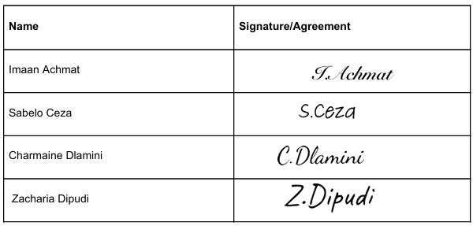

# CHARMAINE DLAMINI

---

### 📞 **CONTACT**
**Phone number:** 0712025518  
**Email:** 222056401@mycput.ac.za  
**Address:** 143 Sir Lowry Rd, Woodstock, 7915  
**LinkedIn:** [linkedin.com/in/charmaine-dlamini](https://www.linkedin.com/in/charmaine-dlamini)  
**Github:** [github.com/charmaine-dlamini-18](https://github.com/charmaine-dlamini-18)

---
### 🚀 **CAREER OVERVIEW**
I am a motivated and dedicated Information Technology student majoring in Applications Development, aspiring to become a Backend Developer. I have a strong foundation in software development and problem-solving, with practical skills in Java, Python, web technologies, APIs, and database concepts gained through academic and personal projects. I am committed to continuous learning and professional growth, seeking an entry-level position, internship, or learnership where I can apply my technical and analytical skills to contribute to high-quality software solutions.

---
### 🎓 **EDUCATION**
Mlonde High School  
National Senior Certificate  
Matric (Grade 12)  
2021

Cape Peninsula University of Technology (CPUT)  
DIPLOMA of ICT in Applications Development  
Final Year

---

### 💼 **WORK EXPERIENCE**
#### **ACADEMIC & PERSONAL PROJECTS (2024-PRESENT)**
**MediQueue Clinic System (Ongoing)**  
* Developing a clinic management system designed to streamline patient appointments, queue management, and staff workflow.  
* Enables patients to book and manage appointments online.  
* Provides real-time queue tracking for doctors and receptionists.  
* Includes secure patient record management and reporting features.  
* Applying Web Technologies, Object-Oriented Programming, and SQL Database Integration.

**Password Vault Application (Ongoing)**
* Developing a secure password management tool to store and retrieve passwords safely.
* Implementing encryption and secure storage mechanisms.
* Building a user-friendly interface for easy password management while applying software development practices.

**Room Tracker Desktop Application**
* Developed a multi-user system to track campus room availability with login/signup and admin panel features.
* Managed client-server communication, network programming, and integrated database storage for persistent data.
* Applied object-oriented design principles and iterative development.

**Student Enrolment System (Java Client-Server Application)**
* Implemented admin and student roles with secure authentication.
* Designed a Swing GUI for course management and enrolment.
* Integrated a Derby database using JDBC and built client-server communication using sockets and serialization.

**ISbani Youth Development**  
* Developed a comprehensive non-government organisation website designed for youth outreach and community engagement.  
* Focused on accessibility and usability.  
* Tech used: HTML, CSS, JavaScript.

**Startup Simulator**  
* Developed an engaging business simulator game that challenges players to build and manage a thriving startup.  
* Features interactive gameplay and strategic decision-making.  
* Built dynamic interfaces and game logic for realistic simulation.  
* Tech used: HTML, CSS, JavaScript.  

---

### 🛠️ **TECHNICAL SKILLS**
**Languages:** Java, Python, HTML, CSS, JavaScript, PHP, SQL/MYSQL  
**Frameworks & APIs:** Fast API, REST API, Spring Boot, React Native, Node.js, Next.js, Laravel  
**Tools & IDEs:** Apache NetBeans, IntelliJ, Figma, Visual Studio Code, Thonny, PyCharm  

---

### 👥 **REFERENCES**
**Mrs Rebecca Bure** (CPUT Lecturer)  
**Phone number:** 0747054403  
**Email:** burer@cput.ac.za  
  
**Nhlanhla Nqoko** (Mentor - MzingweTec)  
**Phone number:** 0606181985  
**Email:** nhlanhlanqoko1@gmail.com

### Mock Video Interview
<video width="600" controls>
    <source src="video/Mock-interview-video.mp4" type="video/mp4">
</video>

---

### **Reflection on Coding in Markdown**
**Situation:**  
During this project, I was required to create and format my CV using Markdown as part of my GitHub portfolio. I had limited prior experience using Markdown for structuring professional documents.  

**Task:**  
My task was to write a well-structured and readable CV using Markdown syntax while ensuring it was properly displayed on my GitHub Pages site.  

**Action:**  
I learned and applied Markdown syntax such as headings, bullet points, bold text, and links to organise my CV content. I structured sections like education, skills, and experience clearly to improve readability. I also tested how the Markdown rendered on GitHub and adjusted where formatting did not appear as expected.  

**Result:**  
As a result, I was able to create a clean, structured, and professional-looking CV. I improved my understanding of Markdown and how it can be used for documentation. This skill will be useful in future projects, especially when working with README files and technical documentation.  

---

### **Reflection on Using GitHub Pages**
**Situation:**  
As part of this assignment, I was required to publish my portfolio using GitHub Pages. The portfolio included my CV coded in Markdown and my mock interview.  

**Task:**  
My task was to deploy my portfolio online using GitHub Pages and make sure that my CV and mock interview were accessible and displayed correctly.  

**Action:**  
I created a GitHub repository and added my CV written in Markdown as well as the mock interview. I then enabled GitHub Pages to publish the site. During the process, I experienced challenges with getting the content to display correctly and ensuring updates reflected on the live site. I checked my commits, refreshed the page, and ensured everything was properly uploaded.  

**Result:**  
In the end, I successfully published my portfolio and accessed it online. I gained a better understanding of how GitHub Pages works and how to deploy content. This experience improved my confidence in using GitHub and publishing work online.  

---

### **Reflection on Mock Interview**
**Situation:**  
As part of this project, I had to complete a mock interview to simulate a real-life IT job interview. This was my first time doing a recorded interview, and I felt stressed and nervous.  

**Task:**  
My task was to answer interview questions clearly and professionally within a limited time of 2 minutes while demonstrating confidence and communication skills. The questions were divided into behavioural, situational, technical, and general categories, and I had to choose one question from each category and understand what each required before answering.  

**Action:**  
I prepared by reviewing common interview questions and planning my responses. However, during the interview, I struggled with time management and keeping my answers within the 2-minute limit. I also found it difficult to structure my answers clearly under pressure.  

**Result:**  
This experience helped me identify areas for improvement, particularly in confidence, time management, and structuring answers. I now understand the importance of staying calm and organising my thoughts before responding. Although I faced challenges, I feel more prepared for future interviews.

---

## Agile Team Charter – LaundryPickupPro

## 1. Team Purpose & Vision

### Why do we exist as a team?

We exist to design and develop a solution that addresses the lack of convenient laundry access for residents in Maitland, Observatory, and Woodstock.

**Team mission:**

To create a reliable and affordable laundry pick-up and drop-off service that saves time, reduces effort, and improves the daily lives of residents. We are solving the problem of inconvenient and inaccessible laundry services for working adults with busy schedules, elderly residents who struggle with physical tasks, and people living in apartments without laundry facilities.

**Success definition:**

We will be successful when our final product is:

- Fully developed and functional.
- The solution clearly addresses the problem people are facing.
- The system is usable, practical and meets user needs.

**Product / Service:**

We are responsible for delivering a laundry pick-up and drop-off service that includes:

- Booking system.
- Laundry collection and delivery process.
- Integration with laundromat owners.
- Affordable prices.
- Convenient scheduling.

---

## 2. Team Members & Roles

### Who is on the team and how do we contribute?

| Name | Role | Key Responsibilities |
|---|---|---|
| Imaan Achmat | Product Owner | Comes up with the main idea, keeps the backlog organised and decides what should be done first. Focuses on making sure the team builds something useful that people need. |
| Sabelo Ceza | Agile Lead | Keeps the team organised, ensures everyone knows what to work on, leads meetings, helps solve problems, and makes sure the team stays on track. |
| Zacharia Dipudi | UI/UX Designer | Makes sure the app is simple and easy to use. Plans user navigation and designs screens before coding starts. |
| Charmaine Dlamini | Developer / Analyst / Tester | Builds the system, helps determine how features should work, tests features, and fixes bugs to ensure the system runs smoothly. |

---

## 3. Ways of Working

### How we work together day to day

### 3.1 Agile Framework

Our team follows the Agile methodology. We use a product backlog to list and prioritise tasks, and a logbook to track task progress, updates, and team contributions.

### 3.2 Ceremonies

| Ceremony | Frequency | Purpose |
|---|---|---|
| Daily Stand-up | Every working day | Share completed work, current tasks, and any challenges or obstacles. |
| Planning | Once a week | Plan upcoming tasks, assign responsibilities, and set priorities for the week. |
| Review / Demo | End of each milestone or sprint | Show completed tasks and gather feedback from team members. |
| Retrospective | After each milestone or sprint | Reflect on what went well, challenges faced, and how the team can improve. |

---

## 4. Working Agreements

### Rules we agree to follow as a team

- We show up prepared and on time.
- We respect timeboxes and deadlines.
- We give constructive feedback respectfully.
- We raise challenges early to avoid delays.
- We commit to continuous improvement.
- We communicate regularly through group chat or meetings.
- We complete assigned tasks before deadlines.
- We support each other when challenges arise.
- We keep project files and documentation updated.
- We check our work after completing tasks to make sure everything aligns.

---

## 5. Communication

### How and when we communicate

**Primary channels:**

- **Microsoft Teams:** Used for regular meetings, quick updates, daily stand-ups, and screen sharing when needed.
- **WhatsApp:** Used for urgent messages and frequent communication.
- **Email:** Used for formal communication, reports, and document sharing.

**Response-time expectations:**

- During core hours (08:00–17:00, Monday–Friday), messages should receive a response within 1–2 hours.
- Urgent messages, including those marked urgent or sent via WhatsApp, should receive a response within 30 minutes.
- Non-urgent communication may receive a response within 12 hours.

**Remote / hybrid norms:**

- Team members should be available online during core hours.
- Cameras should be on during important meetings but are optional for casual check-ins.
- Team members must maintain clear status updates on Teams, such as available, busy, or offline.
- If unavailable, team members should notify the team ahead of time.

---

## 6. Decision-Making

### How decisions are made

- [ ] Consensus
- [ ] Team vote

The team will aim for consensus where possible. If an agreement cannot be reached, a majority vote will be used to make the final decision.

**Escalation path if we're stuck:**

- Discuss the issues as a team.
- Revisit our project goals.
- Seek guidance from our lecturer if needed.

---

## 7. Definition of Done (DoD)

### When is work really "done"?

- When the application is fully developed and working as intended.
- When the application clearly addresses the problem it was designed to solve.
- When the application is usable, practical, and meets user needs.
- When all tests have been completed successfully and the system runs without errors.
- When the project documentation is updated.
- When the Product Owner has approved the work.
- When the system/application is deployed to the agreed environment.
- When there are no critical bugs or issues found.

---

## 8. Core Values & Behaviours

### How we treat each other

- **Respect:** Every team member is treated with dignity. We listen to others' opinions and value everyone's contributions, regardless of their role.
- **Transparency:** We communicate openly and honestly and share information so everyone stays informed about decisions and progress.
- **Accountability:** We take responsibility for completing tasks, meeting deadlines, and owning our successes and failures.
- **Trust:** We trust each other to complete our work, help one another, and create a safe environment where everyone can confidently share ideas.
- **Learning mindset:** We remain open to feedback, improve our skills, and treat challenges and mistakes as opportunities to learn and grow.
- **Collaboration:** We share ideas and support one another to achieve project goals, recognising that combining our strengths leads to better results.

---

## 9. Risks & Constraints

### What could impact our success?

### Known risks

- Team members may miss deadlines due to academic workload.
- Miscommunication between team members may cause confusion.
- Technical issues or bugs may delay development.
- Team members may have conflicting schedules for meetings or collaboration.
- Delayed tasks may affect the overall project timeline and progress.
- Lack of user feedback could affect the quality of the final product.

### Dependencies

- Availability and commitment of all team members.
- Access to reliable internet and development tools, such as IDEs, GitHub, and database tools.
- Access to a working database and hosting platform.
- Timely feedback from users or test participants.
- Lecturer guidance and approval at different stages of the project.

### Constraints (time, budget, tools, skills)

- Limited time due to the academic schedule and other module deadlines.
- No budget, meaning reliance on free tools and platforms.
- Limited access to advanced development tools.
- Varying skill levels within the team, with some members still learning certain technologies.
- Dependence on free hosting or university resources that may have restrictions.

---

## 10. Review & Improvement

### Keeping the charter alive

**Charter reviewed every:**

- [ ] Retrospective

Our team will review and update the charter during retrospectives to ensure it remains relevant and aligned with our project progress.

**Last updated:** 04 May 2026

---

## 11. Goals and Milestones

### SMART Goals

- Develop a user-friendly laundry pick-up and drop-off service platform that allows customers to book services, schedule pickups, and track orders before the end of the project timeline.
- Ensure that our app is affordable and practical for residents by focusing on convenience and accessibility.
- Test the app properly before deployment to make sure all features work correctly and users can navigate the system easily.
- Complete all planned project tasks within the given project timeline and contribute effectively as a team throughout the development process.

### Project Milestones

| Milestone | Description | Target Date |
|---|---|---|
| Project Planning | Define project scope, goals, requirements, and team responsibilities. | Week 1 |
| Requirements Gathering | Conduct research and gather user and business requirements. | Week 2 |
| UI/UX Design | Create wireframes, interface designs, and user navigation flow. | Week 3 |
| Coding/Implementation | Begin developing the core system structure, screens, and basic functionality. | Week 4 |
| Database Design & Setup | Design and create the database structure for customers, bookings, and deliveries. | Week 5 |
| System Integration | Integrate frontend, backend, and database components. | Week 6 |
| Testing & Bug Fixing | Perform functionality testing and resolve identified issues. | Week 7 |
| Final Review & Deployment | Prepare the final system, documentation, and presentation. | Week 8 |

---

## 12. Team Commitment

### Our agreement to this charter

By working on this team, we commit to the principles and agreements outlined above.

---

## Reflection on Agile Team Charter

### Situation

As part of the LaundryPickupPro project, our team needed a clear agreement on how we would work together, communicate, share responsibilities, and complete our project tasks.

### Task

My responsibility was to contribute to the development process while helping ensure that the team's working agreements, risks, and constraints were clearly documented.

### Action

I contributed to defining the team's working agreements and identifying risks and constraints that could affect our progress. We also documented our Agile practices, communication channels, milestones, and expectations for completing and reviewing tasks.

### Result

The Agile Team Charter provided a shared understanding of team responsibilities, communication expectations, project goals, and ways of working. It helped us organise our work, identify possible challenges, and maintain a common direction throughout the project.

The Agile Team Charter also helped me better understand Agile practices, accountability, communication, and the importance of planning and testing in software development. This experience showed me how a well-organised team can work together towards delivering a functional application within a given timeline.

---

# User Stories and Tasks – LaundryPickupPro

---

## Sprint 1

### Sprint 1 – Day 1: Problem Definition

**User Story:**

As a member of the team, I want to clearly define the problem our service aims to solve so that we can build a solution that addresses our target customers' needs and provides value to the business.

**Due date:** May 18, 10:44 PM

**Tasks:**
- Identify the problem – Charmaine Dlamini
- Problem objectives – Zacharia Dipudi
- Problem scope – Wendy Bayise
- Identify key problem areas – Imaan Achmat
- Identify target audience – Sabelo Ceza

---

### Sprint 1 – Day 2: Agile Team Charter

**User Story:**

As a member of the team, I want to create an Agile Team Charter so that everyone understands the project's purpose, vision, roles, responsibilities, and team commitments.

**Due date:** May 19, 8:44 AM

**Tasks:**
- Purpose and vision – Sabelo Ceza
- Core values and behaviours – Imaan Achmat
- Definition of Done – Wendy Bayise
- Role assignment – Charmaine Dlamini
- Team commitments – Zacharia Dipudi

---

### Sprint 1 – Day 3: Communication Plan

**User Story:**

As a member of the team, I want to create a communication plan so that everyone knows how, when, and where we will communicate, collaborate, and share project information as a group.

**Due date:** May 20, 8:44 AM

**Tasks:**
- Identify communication tools – Charmaine Dlamini
- Document communication plan – Wendy Bayise
- Communication responsibilities – Zacharia Dipudi
- Establish communication schedule – Imaan Achmat
- Establish feedback process – Sabelo Ceza

---

### Sprint 1 – Day 4: Conduct User Research

**User Story:**

As a member of the team, I want to conduct user research so that we can understand the needs of our customers and target market and develop a service that meets their expectations.

**Customer User Story:**

As a potential customer, I want to complete a survey questionnaire so that I can share my laundry needs, preferences, and expectations to help improve the service.

**Due date:** May 21, 8:44 AM

**Tasks:**
- Prepare research questions – Imaan Achmat
- Create survey questionnaire – Sabelo Ceza
- Distribute survey – Zacharia Dipudi
- Define user requirements – Charmaine Dlamini
- Compile research report – Wendy Bayise

---

### Sprint 1 – Day 5: Summary of Findings

**User Story:**

As a member of the team, I want to analyse, summarise, and organise the research findings so that we can identify user needs and improve our service.

**Due date:** May 22, 8:44 AM

**Tasks:**
- Identify user needs – Zacharia Dipudi
- Analyse survey responses – Charmaine Dlamini
- Review research results – Imaan Achmat
- Organise collected data – Sabelo Ceza
- Summarise key findings – Wendy Bayise

---

## Sprint 2

### Sprint 2 – Day 1: Competitor Analysis

**User Story:**

As a business owner, I want to analyse competitors and define the value proposition so that the service can compete effectively in the market.

**Due date:** May 25, 5:00 PM

**Tasks:**
- Identify competitors – Wendy Bayise
- Competitor comparison – Charmaine Dlamini
- Analyse strengths and weaknesses – Imaan Achmat
- Identify market gaps – Sabelo Ceza
- Document findings – Zacharia Dipudi

---

### Sprint 2 – Day 2: Project Feasibility

**User Story:**

As a business owner, I want to identify the required resources, estimate project costs, and evaluate the project's feasibility so that I can determine whether the laundry pickup and drop-off service is practical, affordable, and viable to implement.

**Due date:** May 26, 9:00 AM

**Tasks:**
- Identify the required resources – Wendy Bayise
- Estimate product costs – Charmaine Dlamini
- Evaluate project viability – Zacharia Dipudi
- Document feasibility findings – Sabelo Ceza
- Review feasibility results – Imaan Achmat

---

### Sprint 2 – Day 3: Project Risk Analysis

**User Story:**

As a business owner, I want to identify and assess potential project risks so that I can develop strategies to reduce potential problems and make informed decisions.

**Due date:** May 27, 8:44 AM

**Tasks:**
- Market risk – Imaan Achmat
- Financial risk – Wendy Bayise
- Operational risk – Zacharia Dipudi
- Technical risk – Sabelo Ceza
- Document risk mitigation plan – Charmaine Dlamini

---

### Sprint 2 – Day 4: Marketing Strategy

**User Story:**

As a business owner, I want to create a marketing strategy so that more people know about our service.

**Due date:** May 28, 8:44 AM

**Tasks:**
- Create marketing plan – Charmaine Dlamini
- Choose marketing channels – Zacharia Dipudi
- Set marketing budget – Sabelo Ceza
- Plan promotional campaigns – Wendy Bayise
- Research marketing methods and channels – Imaan Achmat

---

### Sprint 2 – Day 5: Value Proposition

**User Story:**

As a business owner, I want to define the value proposition so that our service stands out from competitors and attracts more customers.

**Due date:** May 29, 9:00 AM

**Tasks:**
- Define the business's unique value – Imaan Achmat
- Emotional benefit – Zacharia Dipudi
- Functional benefit – Sabelo Ceza
- Financial/time-saving benefit – Charmaine Dlamini
- Document findings – Wendy Bayise

---

### Sprint 2 – Day 6: Requirements Document (Functional and Non-Functional)

**User Story:**

As a business owner, I want to define and document the functional and non-functional requirements so that the development team understands what needs to be built.

**Due date:** May 30, 9:00 AM

**Tasks:**
- Identify functional and non-functional requirements – Wendy Bayise
- Validate all requirements – Charmaine Dlamini
- Prioritise requirements – Imaan Achmat
- Compile and review findings – Zacharia Dipudi
- Finalise requirements document – Sabelo Ceza

---

## Sprint 3

### Sprint 3 – Day 1: Work Breakdown Structure (WBS)

**User Story:**

As a project manager, I want to create a Work Breakdown Structure so that the project is organised into manageable tasks and completed efficiently.

**Due date:** June 1, 9:00 AM

**Tasks:**
- Identify major project deliverables – Charmaine Dlamini
- Identify project milestones – Sabelo Ceza
- Break deliverables into smaller tasks – Sabelo Ceza
- Categorise tasks – Zacharia Dipudi
- Identify task dependencies – Imaan Achmat
- Assign responsibilities – Imaan Achmat
- Set task durations – Wendy Bayise
- Review WBS – Zacharia Dipudi and Wendy Bayise
- Finalise WBS – Charmaine Dlamini

---

### Sprint 3 – Day 2: Sprint Plans

**User Story:**

As a Scrum Master, I want to create sprint plans so that the team clearly understands the sprint goals and the tasks to be completed.

**Due date:** June 2, 9:00 AM

**Tasks:**
- Define sprint goals – Sabelo Ceza
- Create sprint backlog – Zacharia Dipudi
- Prioritise sprint tasks – Charmaine Dlamini
- Assess team capacity – Imaan Achmat
- Review and finalise sprint plan – Wendy Bayise

---

### Sprint 3 – Day 3: User Stories

**User Story:**

As a project manager, I want to create user stories so that the team clearly understands the project requirements and deliverables.

**Due date:** June 4, 9:00 AM

**Tasks:**
- Identify system users – Imaan Achmat
- Write user stories – Wendy Bayise
- Define acceptance criteria – Sabelo Ceza
- Review user stories – Charmaine Dlamini
- Double-check and finalise user stories – Zacharia Dipudi

---

### Sprint 3 – Day 4: UML Diagrams

**User Story:**

As a software developer, I want to create UML diagrams so that I can clearly understand the system's structure and functionality before development begins.

**Due date:** June 8, 9:00 AM

**Tasks:**
- Draw use case diagram – Sabelo Ceza
- Draw activity diagram – Charmaine Dlamini
- Draw sequence diagram – Wendy Bayise
- Draw class diagram – Imaan Achmat
- Review and finalise UML diagrams – Zacharia Dipudi

---

### Sprint 3 – Day 5: Progress Report

**User Story:**

As a business owner, I want to review a progress report so that I can monitor the project's progress and make changes if needed.

**Due date:** June 9, 9:00 AM

**Tasks:**
- Record sprint achievements – Sabelo Ceza
- Summarise completed tasks – Zacharia Dipudi
- Identify challenges – Wendy Bayise
- Document solutions – Charmaine Dlamini
- Update project progress and finalise progress report – Imaan Achmat

---

## Sprint 4

### Sprint 4 – Day 1: PowerPoint Presentation Slides

**User Story:**

As a member of the team, I want to prepare a business overview PowerPoint presentation so that we can clearly present our business idea to the lecturer.

**Due date:** July 14, 9:00 AM

**Tasks:**
- Gather all the required content and information – Zacharia Dipudi
- Create presentation slides – Sabelo Ceza
- Explain key features – Wendy Bayise
- Review and finalise content – Charmaine Dlamini
- Finalise presentation slides – Imaan Achmat

---

### Sprint 4 – Day 2: Business Overview and Problem Statement

**User Story:**

As a member of this team, I want to create a business overview and problem statement so that everyone understands our project.

**Due date:** July 15, 7:00 PM

**Tasks:**
- Research business background – Sabelo Ceza
- Define the business overview – Charmaine Dlamini
- Identify the problem statement – Imaan Achmat
- Identify target audience – Wendy Bayise
- Review and refine content – Zacharia Dipudi

---

### Sprint 4 – Day 3: Presentation Delivery

**User Story:**

As a member of the team, I want to deliver the business overview presentation so that the lecturer understands our business and provides feedback.

**Due date:** July 16, 8:44 AM

**Tasks:**
- Assign presenters – Sabelo Ceza
- Schedule rehearsal – Charmaine Dlamini
- Practise presentation – Imaan Achmat and Wendy Bayise
- Make final improvements – Zacharia Dipudi
- Present to the lecturer – Imaan Achmat and Wendy Bayise

---

### Sprint 4 – Day 4: Presentation Update

**User Story:**

As a member of the team, I want to update the PowerPoint presentation so that we can improve it based on the lecturer's feedback.

**Due date:** July 17, 9:00 AM

**Tasks:**
- Review presentation content – Wendy Bayise
- Collect team feedback – Imaan Achmat
- Update presentation slides – Sabelo Ceza
- Review and finalise presentation – Charmaine Dlamini
- Presentation submission – Zacharia Dipudi, Charmaine Dlamini, Imaan Achmat, Wendy Bayise, and Sabelo Ceza

---

## Sprint 5

### Sprint 5 – Day 1: Trello Board Setup and Management

**User Story:**

As a Scrum Master, I want to set up and manage the Trello board so that the team can track sprint progress and manage tasks effectively.

**Due date:** July 21, 10:23 PM

**Tasks:**
- Organise the project into clear tasks and subtasks – Sabelo Ceza
- Group tasks into the correct stages of the project – Imaan Achmat
- Add deadlines, priorities, and task details – Wendy Bayise
- Track the progress of each task and update its status – Charmaine Dlamini
- Review the board regularly and improve the task plan when needed – Zacharia Dipudi

---

### Sprint 5 – Day 2: Application Features

**User Story:**

As a Product Owner, I want to define the application features so that the development team has a clear understanding of the functionality to implement.

**Due date:** July 24, 10:23 PM

**Tasks:**
- Brainstorm core features – Charmaine Dlamini
- Define feature requirements – Wendy Bayise
- Prioritise features – Zacharia Dipudi
- List optional features – Imaan Achmat
- Review and finalise feature list – Sabelo Ceza

---

### Sprint 5 – Day 3: Low-Fidelity Wireframes

**Development Team User Story:**

As a member of the team, I want to create the application's low-fidelity wireframes so that the team has a clear visual representation of the system's layout and user interface before development begins.

**Target Audience/Customer User Story:**

As a working professional, I want to use an easy-to-navigate laundry pickup and delivery application so that I can book and manage my laundry services quickly and conveniently without disrupting my busy schedule.

**Due date:** July 28, 10:23 PM

**Tasks:**
- Identify required application screens – Charmaine Dlamini
- Sketch low-fidelity wireframes – Zacharia Dipudi
- Define screen layout – Sabelo Ceza
- Review wireframes – Imaan Achmat
- Update low-fidelity wireframes based on team feedback – Wendy Bayise

---

### Sprint 5 – Day 4: High-Fidelity User Interface Design (UI/UX)

**User Story:**

As a UI/UX designer, I want to create a simple and attractive high-fidelity application design so that users can easily use the application.

**Due date:** July 29, 10:23 PM

**Tasks:**
- Select colour scheme, fonts, and icons – Wendy Bayise
- Design detailed user interface screens – Charmaine Dlamini
- Create consistent design style – Zacharia Dipudi
- Review UI designs – Imaan Achmat
- Improve user experience – Sabelo Ceza

---

## Sprint 6

### Sprint 6 – Day 1: Interactive Figma Prototype

**Team Member User Story:**

As a team member, I want to create a working prototype so that we can show how the application will work and look before we start building it.

**Customer User Story:**

As a customer, I want to try a prototype of the application so that I can check if it is simple and easy to use before it is implemented.

**Due date:** July 31, 10:23 PM

**Tasks:**
- Create clickable prototype – Sabelo Ceza
- Add screen interactions – Charmaine Dlamini
- Test the prototype flow – Wendy Bayise
- Collect feedback – Imaan Achmat
- Improve prototype based on feedback – Zacharia Dipudi

---

### Sprint 6 – Day 2: Prototype Testing

**User Story:**

As a member of this team, I want to test the prototype so that we can identify and fix any usability issues before development.

**Due date:** August 1, 3:50 PM

**Tasks:**
- Test screen navigation – Sabelo Ceza
- Test interactive elements – Charmaine Dlamini
- Identify usability issues – Wendy Bayise
- Collect team feedback – Imaan Achmat
- Record testing results – Zacharia Dipudi

---

### Sprint 6 – Day 3: Prototype Demonstration

**User Story:**

As a member of this team, I want to demonstrate this prototype so that users can review the design and provide feedback.

**Due date:** August 2, 3:50 PM

**Tasks:**
- Prepare prototype walkthrough – Sabelo Ceza
- Demonstrate application features – Charmaine Dlamini
- Explain user flow – Wendy Bayise
- Gather lecturer feedback – Zacharia Dipudi
- Record improvement suggestions – Imaan Achmat

---

### Sprint 6 – Day 4: Prototype Improvements

**Team Member User Story:**

As a member of this team, I want to improve the prototype based on feedback so that the application is ready for the next stage of development.

**Customer User Story:**

As a customer, I want an easy-to-use and visually appealing application so that I can complete my tasks quickly and without confusion.

**Due date:** August 3, 3:50 PM

**Tasks:**
- Apply lecturer feedback – Sabelo Ceza
- Improve screen navigation – Wendy Bayise
- Fix prototype issues – Charmaine Dlamini
- Improve user experience – Zacharia Dipudi
- Finalise prototype – Imaan Achmat

---

## Sprint 7

### Sprint 7 – Day 1: Database Planning

**Database Administrator User Story:**

As a database administrator, I want to plan the database structure so that the application stores and manages data efficiently, securely, and accurately.

**Customer User Story:**

As a customer, I want my personal information and laundry orders to be stored securely so that I can trust the application with my details.

**Due date:** August 4, 9:00 AM

**Tasks:**
- List database tables with attributes – Wendy Bayise
- Identify entities and relationships – Imaan Achmat
- Create ERD/tables – Zacharia Dipudi
- Define primary and foreign keys – Sabelo Ceza
- Document database planning requirements – Charmaine Dlamini

---

### Sprint 7 – Day 2: Authentication Planning

**User Story:**

As a resident (customer), I want to log in securely so that my personal information and orders are protected.

**Due date:** August 5, 9:00 AM

**Tasks:**
- Identify authentication requirements – Wendy Bayise
- Define password and account security rules – Charmaine Dlamini
- Define user roles and access levels – Zacharia Dipudi
- Research and select authentication method – Imaan Achmat
- Review and finalise authentication plan – Sabelo Ceza

---

### Sprint 7 – Day 3: Security Planning

**User Story:**

As a system analyst, I want to plan the application's security measures so that user data and system resources are protected from unauthorised access and potential security threats.

**Due date:** August 6, 9:00 AM

**Tasks:**
- Security requirements – Zacharia Dipudi
- Plan user account and personal data security – Wendy Bayise
- Plan backup and recovery – Imaan Achmat
- Plan secure payment handling – Sabelo Ceza
- Review and finalise security plan – Charmaine Dlamini

---

### Sprint 7 – Day 4: Database Review and Finalisation

**User Story:**

As a database administrator, I want to review and finalise the database design so that it is accurate, complete, and ready for implementation.

**Due date:** August 7, 9:00 AM

**Tasks:**
- Review the database schema – Charmaine Dlamini
- Review ERD/tables – Zacharia Dipudi
- Verify table relationships and constraints – Imaan Achmat
- Apply team feedback and make improvements – Sabelo Ceza
- Finalise database design – Wendy Bayise

---

## Sprint 8

### Sprint 8 – Day 1: Project and GitHub Setup

**User Story:**

As a team member, I want to set up the project and GitHub repository so that the team can collaborate efficiently and maintain version control throughout the project.

**Due date:** August 7, 10:00 PM

**Tasks:**
- Project and GitHub repository creation – Charmaine Dlamini
- Set up Supabase backend integration – Sabelo Ceza
- Project structure and navigation setup – Imaan Achmat
- Project documentation – Zacharia Dipudi
- Application configuration and dependency installation – Wendy Bayise

---

### Sprint 8 – Day 2: Screen Design

**User Story:**

As a software developer, I want to design the application screens so that users have a consistent, intuitive, and visually appealing interface to interact with the system.

**Due date:** August 10, 9:00 AM

**Tasks:**
- Registration and login screen – Charmaine Dlamini
- Landing screen – Wendy Bayise
- User home screen – Imaan Achmat
- Pickup and delivery address screen – Zacharia Dipudi
- Profile screen – Sabelo Ceza

---

### Sprint 8 – Day 3: Screen Design

**User Story:**

As a customer, I want well-designed application screens so that I can easily navigate the system and complete my laundry bookings without confusion.

**Due date:** August 14, 9:00 AM

**Tasks:**
- Forgot password and reset screen – Charmaine Dlamini
- Booking screen and functionality – Imaan Achmat
- Order details and confirmation screen – Zacharia Dipudi
- Order history screen – Wendy Bayise
- Edit profile screen – Sabelo Ceza

---

### Sprint 8 – Day 4: Screen Design

**Driver User Story:**

As a driver, I want a dashboard that displays my assigned pickups and deliveries so that I can efficiently manage my daily routes and update order statuses.

**Customer User Story:**

As a customer, I want to make secure payments through the application so that my payment information is protected and my booking is completed safely.

**Due date:** August 17, 9:00 AM

**Tasks:**
- Payment screen and functionality – Zacharia Dipudi
- Live order tracking screen and functionality – Imaan Achmat
- Notifications screen and functionality – Wendy Bayise
- Help and support screen and functionality – Charmaine Dlamini
- Driver dashboard – Sabelo Ceza

---

### Sprint 8 – Day 5: Screen Design

**User Story:**

As an administrator, I want clear and organised management screens so that I can manage customer accounts, orders, and deliveries efficiently while assisting users when needed.

**Due date:** August 19, 9:00 AM

**Tasks:**
- Admin dashboard – Charmaine Dlamini
- Customer management screen and functionality – Imaan Achmat
- Driver management screen and functionality – Wendy Bayise
- Order management screen and functionality – Zacharia Dipudi
- Navigation/route screen and functionality – Sabelo Ceza

---

## Sprint 9

### Sprint 9 – Day 1: Unit Testing

**User Story:**

As a software tester, I want to perform unit testing on individual application components so that defects can be identified early and each component functions correctly before integration.

**Due date:** August 24, 9:00 AM

**Tasks:**
- Conduct unit testing – Zacharia Dipudi
- Payment testing – Sabelo Ceza
- Test user authentication – Charmaine Dlamini
- Test database operations – Sabelo Ceza
- Record test results – Imaan Achmat
- Identify and fix bugs – Wendy Bayise and Imaan Achmat
- Test navigation between screens – Charmaine Dlamini
- User acceptance testing – Wendy Bayise
- Test across multiple devices – Zacharia Dipudi

---

### Sprint 9 – Day 2: System Testing

**User Story:**

As a tester, I want to test all the application features so that I can find and fix problems before the application is released.

**Due date:** August 26, 10:00 PM

**Tasks:**
- Prepare test environment – Zacharia Dipudi
- Create system and integration test cases – Imaan Achmat
- Test user authentication and authorisation – Charmaine Dlamini
- Test frontend and Supabase integration – Sabelo Ceza
- Log and fix defects – Wendy Bayise

---

### Sprint 9 – Day 3: Database Testing

**User Story:**

As a database administrator, I want to test the database so that data is stored, retrieved, and managed accurately, securely, and efficiently.

**Due date:** August 28, 11:00 PM

**Tasks:**
- Test real-time features – Zacharia Dipudi
- Test data validation – Wendy Bayise
- Verify security policies – Sabelo Ceza
- Test API endpoints – Imaan Achmat
- Document test results – Charmaine Dlamini

---

### Sprint 9 – Day 4: Debugging

**User Story:**

As a software developer, I want to debug the application so that errors are identified and resolved, ensuring the system functions correctly and efficiently.

**Due date:** September 1, 9:00 AM

**Tasks:**
- Identify bugs – Imaan Achmat
- Fix code issues – Sabelo Ceza
- Debug database errors – Charmaine Dlamini
- Debug API integration – Wendy Bayise
- Update bug log – Zacharia Dipudi

---

### Sprint 9 – Day 5: Final Testing

**Software Tester User Story:**

As a software tester, I want to perform final testing so that the application is fully functional, meets all requirements, and is ready for deployment.

**Customer User Story:**

As a customer, I want to use a fully tested application so that I can book, track, and manage my laundry orders without problems.

**Due date:** September 4, 11:00 PM

**Tasks:**
- Perform end-to-end testing – Charmaine Dlamini
- Verify all features – Zacharia Dipudi
- Verify database operations – Sabelo Ceza
- Test performance – Wendy Bayise
- Perform user acceptance testing (UAT) – Imaan Achmat
- Confirm deployment readiness – Sabelo Ceza
- Prepare final test report – Wendy Bayise

---

## Sprint 10

### Sprint 10 – Day 1: Project Documentation

**User Story:**

As a software developer, I want to prepare the system documentation so that the system's architecture, functionality, and technical implementation are clearly documented for maintenance and future development.

**Due date:** September 4, 9:00 AM

**Tasks:**
- Document system overview and project objectives – Wendy Bayise
- Document the system architecture – Sabelo Ceza
- Document the database structure and API endpoints – Zacharia Dipudi
- Combine the documents – Charmaine Dlamini
- Review and finalise all project documentation – Imaan Achmat

---

### Sprint 10 – Day 2: System Deployment

**Software Developer User Story:**

As a software developer, I want to deploy the system so that the application is available to users in a secure, stable, and production-ready environment.

**Customer User Story:**

As a customer, I want the application to be available online so that I can book and manage my laundry orders anytime and anywhere.

**Due date:** September 7, 9:00 AM

**Tasks:**
- Set up the production database – Wendy Bayise
- Configure security settings and environment variables – Imaan Achmat
- Configure the production/server environment – Zacharia Dipudi
- Deploy the application to the server – Sabelo Ceza
- Verify that the deployed system is working correctly – Charmaine Dlamini

---

### Sprint 10 – Day 3: Review and Improvement

**User Story:**

As a resident, I want to provide feedback on the application so that future improvements address my needs and enhance my experience.

**Due date:** September 16, 9:00 AM

**Tasks:**
- Gather feedback from users – Imaan Achmat
- Identify bugs and performance issues – Charmaine Dlamini
- Implement improvements and bug fixes – Zacharia Dipudi
- Update documentation based on the improvements – Sabelo Ceza

---
